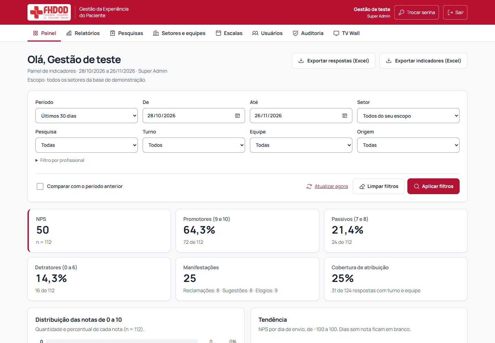
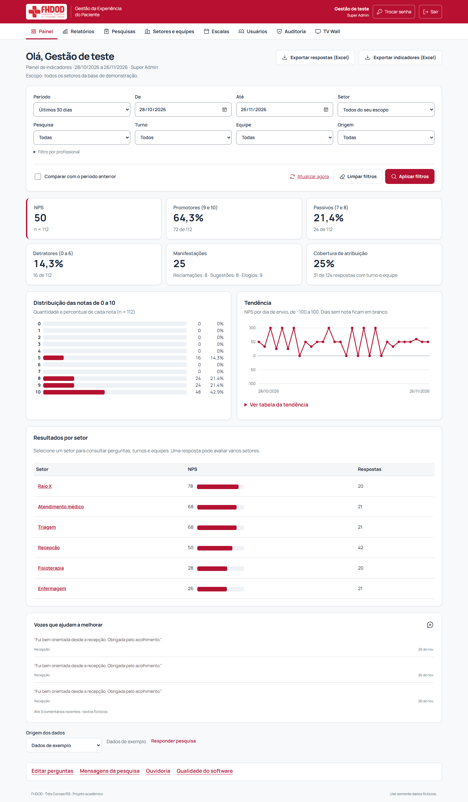
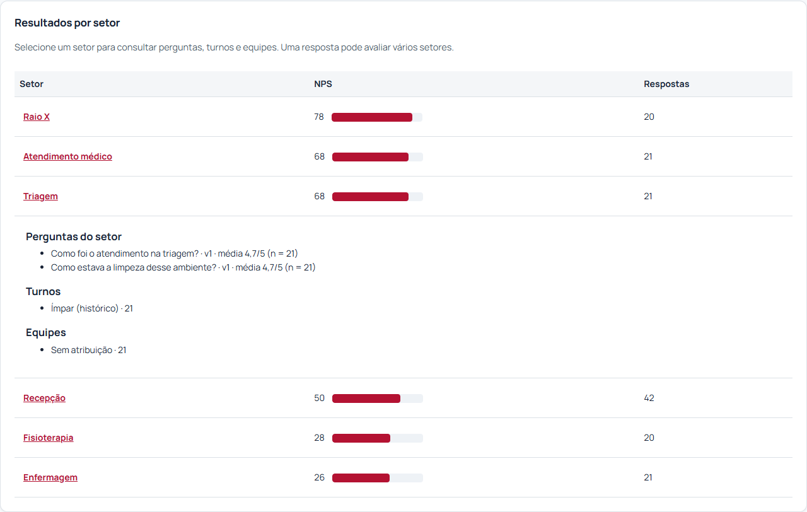
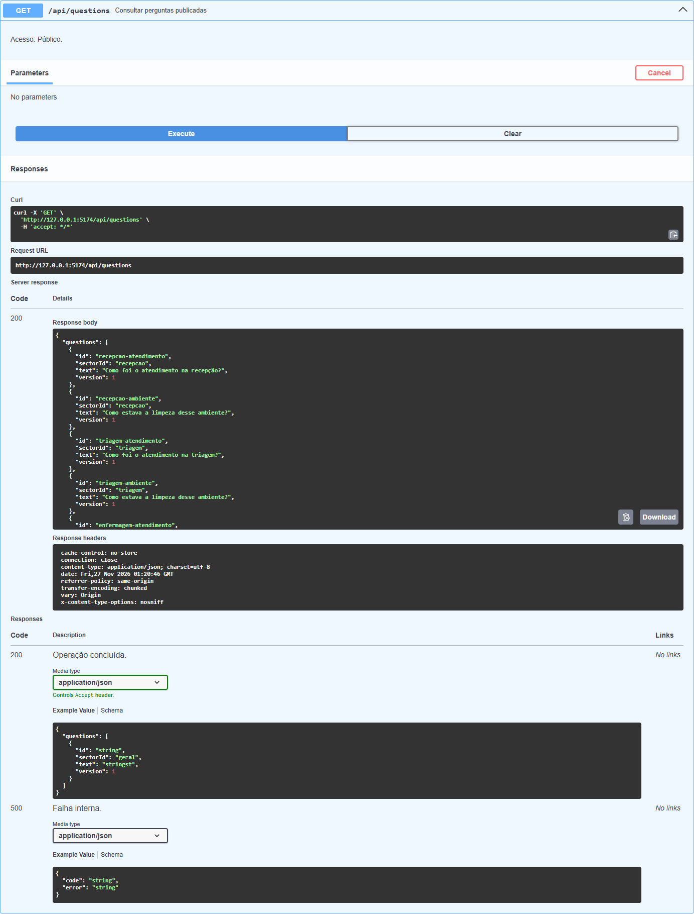
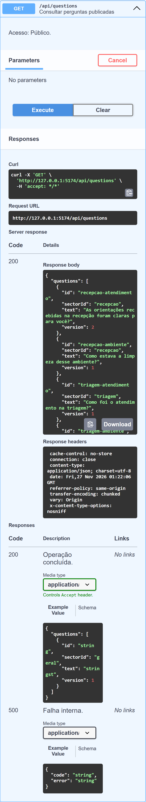

# Complemento do manual — painel e API atuais

Este complemento substitui as instruções de dashboard antigas quando houver diferença. O PDF de Design continua útil para personas e pesquisa, mas suas imagens anteriores não representam todas as melhorias do PR #1.

## Paciente

1. Abrir o link/QR do setor ou escolher Responder à pesquisa sem conta.
2. Conferir os setores utilizados e iniciar. Responder rostos de 1 a 5 ou pular.
3. Responder a recomendação de 0 a 10; zero é uma nota válida.
4. Se desejar, registrar comentário e classificar elogio, sugestão ou reclamação. Data e turno ajudam a contextualizar, sem serem obrigatórios.
5. Após rosto 1 ou 2, escolher se deseja retorno. Se optar, preencher nome, telefone, relato e autorização; e-mail é opcional. Pode continuar anônimo.
6. Revisar e confirmar. Agradecimento só aparece depois de registro confirmado. Em falha, tentar novamente sem duplicar a pesquisa.

## Gestão e painel

1. Entrar com conta autorizada. Se a senha for temporária, definir a pessoal antes de acessar dados.
2. Conferir a origem dos dados: Servidor usa a base compartilhada; Demonstração usa exemplos identificados.
3. Selecionar período, setor, turno, equipe, formulário, origem e manifestação conforme os controles disponíveis. Clicar em **Aplicar filtros**; alterar o controle sem aplicar não muda silenciosamente o recorte.
4. **Atualizar agora** relê a base e preserva o recorte aplicado. A fonte servidor também atualiza a cada 15 segundos enquanto a página está visível.
5. Ler o denominador dos indicadores. NPS = 100 × (promotores − detratores) / notas válidas. Quatro promotores, um passivo e um detrator produzem NPS 50. Um traço significa base vazia, não zero.
6. **Comparar com o período anterior** usa os mesmos filtros e um intervalo anterior de igual duração. Consultar a base de cada card e a tendência; dias sem nota não viram NPS zero.
7. Abrir um setor para ver perguntas por versão, turnos e equipes. Pesquisa multissetorial conta uma vez no total e em cada setor visitado: somar linhas pode superar o total.
8. **Exportar respostas** baixa respostas/avaliações; **Exportar indicadores** baixa resumo, comparação, distribuição, tendência e setores. Nenhuma exportação inclui contatos ou texto livre.
9. Consultar Relatórios para indicadores complementares; Escalas permite editar conforme perfil. Auditoria é exclusiva do Super Admin e mostra somente tipo/data dos últimos cem eventos.

As capturas acima foram produzidas na revisão do Arthur com dados fictícios e estão versionadas. As capturas de Swagger desta revisão também usam base temporária local, sem contas de produção.

## Ouvidoria e TV

Só Super Admin/Ouvidoria consultam os contatos consentidos. Atualizar a situação de uma manifestação registra acompanhamento, mas não telefona nem envia e-mail ao hospital. A associação de equipe é contextual, não prova culpa individual.

Acessar o TV Wall pelo menu ou rota `/#/tv-wall`. Ele mostra agregados dos últimos trinta dias, atualiza a cada 15 segundos e oculta indicadores/grupos com menos de cinco respostas elegíveis. Não mostra telefone, relato, turno ou equipe individual. Se aparecer exemplo, explicar que são dados fictícios; falhas de atualização são sinalizadas.

## Swagger para a apresentação

1. Abrir https://fhdod-experiencia-paciente.vercel.app/api/docs.
2. Expandir GET /api/health ou GET /api/questions; usar **Try it out → Execute** para uma leitura real.
3. Mostrar o código HTTP e JSON. O health não comprova sozinho o banco; perguntas dependem da persistência.
4. Para rotas privadas, entrar com a própria conta autorizada no mesmo navegador/origem. O cookie HttpOnly é gerenciado pelo navegador, e o Swagger obtém CSRF para escritas.
5. **Execute** em POST/PUT/PATCH altera o ambiente selecionado. Não demonstrar com dados reais ou projetar senhas. GETs públicos são suficientes para a demonstração básica do contrato.

