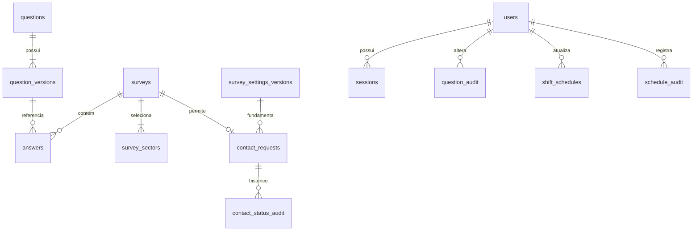

# Modelo de dados e escolha do SGBD

## Necessidades e paradigma

Uma pesquisa seleciona setores, responde versões de perguntas e pode originar um contato consentido. Usuários possuem sessões e permissões; escalas fornecem contexto histórico. Essas relações precisam de chaves, restrições e gravação atômica. Escolhemos **PostgreSQL em produção**, com FK/CHECK/UNIQUE, joins e transações; **SQLite no desenvolvimento**, com instalação simples e testes locais.

MongoDB facilitaria documentos variáveis, mas relações e consistência entre versões exigiriam controle adicional. Redis é adequado para cache/TTL; não substitui automaticamente o histórico relacional e a auditoria. A escolha considera o domínio, não um benchmark inexistente entre SGBDs.

### PostgreSQL e a alternativa MySQL

MySQL também é relacional e atende ao domínio com transações, índices e chaves estrangeiras. O estudante relatou uma preferência do professor por MySQL, mas não uma exigência inequívoca no checklist apresentado. A dupla mantém PostgreSQL nesta entrega por já possuir persistência compartilhada na nuvem, integração funcional, testes e controles de acesso verificados. Não se afirma que PostgreSQL seja universalmente superior ou que a preferência do professor seja irrelevante.

O Supabase é a plataforma; o SGBD utilizado é PostgreSQL. Uma migração real para MySQL requer outro serviço de hospedagem, driver, adaptação de placeholders/UPSERT, DDL, geração de IDs/sequências, locks e políticas de acesso, além de transferência e verificação dos dados. Trocar apenas a URL não é uma migração. É uma possibilidade de evolução, com cópia isolada e testes de paridade antes de substituir a base atual; não foi implementada nem apresentada como concluída. A justificativa deve ser defendida pela dupla e validada com o professor.

## Modelo conceitual

- Uma Pesquisa seleciona de um a seis Setores e contém de zero a sessenta Respostas.
- Cada Resposta referencia uma Versão de Pergunta; uma Pergunta tem uma ou mais versões.
- Uma Pesquisa possui zero ou um Pedido de Contato, fundamentado em uma Versão de Configuração/Consentimento.
- Um Usuário possui sessões e realiza eventos de auditoria.
- Uma Escala é identificada por Setor + Data + Turno. A equipe associada à pesquisa é um snapshot; não depende de uma FK para a escala mutável.

## Modelo lógico

Setores são enum de domínio em `src/domain.ts`, sem tabela SQL: não desenhamos FK para uma tabela inexistente. As tabelas de auditoria preservam ator/evento. `rate_limits` armazena contadores operacionais e `schema_version` registra a evolução. O dicionário separado apresenta todas as colunas, tipos e restrições extraídas do DDL.

## Tipos, integridade e decisões

IDs UUID são armazenados como TEXT e validados na API. Timestamps também usam TEXT ISO 8601 para compatibilidade entre adaptadores; consultas temporais precisam respeitar esse formato. `expires_at` e `until_ms` são epoch em milissegundos. `password_hash`/`password_salt` não são senhas reversíveis.

O DDL admite NPS nulo para registros históricos, mas uma nova submissão exige inteiro de zero a dez. Turnos `par`/`impar` são legados, coexistindo com manhã/tarde/noite e não informado. `settings_json` e `teams_json` são JSON em TEXT; preservam snapshots, mas exigem validação da aplicação. É uma desnormalização explícita, não JSONB nem normalização integral em 3FN.

## Scripts de criação e povoamento

Aplicar `server/postgres-schema.sql` e depois `server/schedules-schema.sql`. O proprietário aplica os grants de `server/postgres-access.sql`. `npm run db:migrate` executa a preparação explícita em transação com advisory lock e insere as quatorze perguntas iniciais, suas versões e a configuração padrão, com `ON CONFLICT DO NOTHING`.

Não se criam pacientes/contatos fictícios na produção. O administrador inicial é provisionado explicitamente por `bootstrap-postgres.mjs`, sem senha no SQL público. Testes PGlite executam o esquema em memória. A role de aplicação não deve receber privilégios administrativos para migração.

## Metadados do painel atual

`surveys.feedback`, `surveys.origin` e `surveys.questionnaire` são colunas TEXT opcionais introduzidas na migração de escalas. O domínio valida reclamação/sugestão/elogio, acesso por QR/link e formulário de origem. Não são tabelas de pacientes. Ausência em registros históricos permanece ausência; não se inventa a origem. A auditoria pública ao Super Admin mostra somente data/tipo dos últimos cem eventos.

Em 26/11, a conferência da nuvem identificou que essas três colunas ainda não existiam. Foram adicionadas de modo idempotente, sem remover dados; também foram aplicados os grants SELECT de colunas de data/tipo de auditoria já previstos no script versionado. Uma submissão fictícia com NPS zero e os novos metadados foi gravada via API, conferida por ID e removida depois. Não houve alteração de senha ou conta real.
