# Experiência do Paciente FHDOD

Relatório do projeto aplicado, consolidado em 5 de novembro de 2026. O sistema é um protótipo acadêmico funcional e publicado. Este texto acompanha o PDF único de entrega, com personas, decisões, mock, manual de uso, processo e critérios de verificação.

## Identificação

- Integrantes: Murilo Mello e Arthur Kaiser.
- Curso: Informática.
- Turma: 63-1.
- Instituição: Escola Técnica Estadual Monteiro Lobato (CIMOL).
- Link público do sistema: https://fhdod-experiencia-paciente.vercel.app (confirmado pelo responsável pela publicação e usado para as capturas desta entrega).
- Fluxo FigJam: https://www.figma.com/board/ESLs3X7Yu6SID1KcxojZPg
- Mock no Figma: https://www.figma.com/design/c9cfayZtbsHNuJ0vvm874X
- Repositório: https://github.com/mello0969/medicare-qualidade-software

Prazo informado na publicação atualizada do Classroom: **6 de novembro de 2026, às 07h30**. O DOCX contém datas de uma versão anterior; prevalece, nesta entrega, a orientação atual enviada pelo estudante. A apresentação tem duração de oito minutos por dupla.

## 1. Problema e proposta

A pesquisa em papel do cenário recebe cerca de três respostas para cada 500 atendimentos, aproximadamente 0,6%. Há formulários incompletos, relatos fora do espaço previsto, baixa identificação do contexto do atendimento e trabalho manual de transcrição. Esse número vem do enunciado e não representa medição realizada pela dupla na FHDOD.

A proposta é uma aplicação acadêmica com pesquisa curta por setor, respostas por toque, avaliação geral obrigatória, comentários opcionais, pedido consentido de contato e painel compartilhado. URLs e QR Codes facilitam o convite após o atendimento. Data e turno informados pelo participante permitem relacionar a pesquisa à equipe registrada na escala, quando existe correspondência exata.

O nome e a identidade visual da Fundação Hospitalar Dr. Oswaldo Diesel contextualizam a demonstração. A aplicação não é um canal oficial do hospital. Usam-se dados fictícios; respostas e solicitações não são encaminhadas à instituição. Não foram realizadas entrevistas ou observações com pacientes e funcionários para elaborar estas personas.

## 2. Personas de projeto

### Maria Helena Duarte, 66 anos - paciente

**Contexto:** personagem fictícia que vai a consultas e exames e, em algumas ocasiões, recebe ajuda da filha com o celular. Responde depois do atendimento, por poucos minutos, sentada ou esperando transporte.

**Objetivos:** registrar como foi tratada, elogiar uma equipe acolhedora e conseguir explicar um problema sem preencher um cadastro extenso.

**Dores:** letras pequenas, formulários longos, dúvidas sobre quais setores avaliar e receio de ter o telefone exposto.

**Familiaridade com tecnologia:** básica. Usa mensagens e câmera, reconhece botões e prefere instruções diretas a menus complexos.

**Canal preferido:** tablet disponibilizado no setor; celular próprio quando consegue abrir o QR Code com facilidade.

**Frase que representa sua visão:** “Quero dizer como fui atendida sem precisar preencher tudo de novo.”

**Consequências no projeto:** uma avaliação por etapa, rostos acompanhados de números e rótulos, opção de pular, sem conta para responder, informação de anonimato e contato opcional. O foco em celular permite acessar pelo QR; o mesmo fluxo funciona no tablet.

### Luciana Fernandes, 42 anos - coordenação da gestão

**Contexto:** personagem fictícia que acompanha a experiência do paciente e precisa identificar diferenças entre setores e plantões. Trabalha em conjunto com a Ouvidoria, que realiza o retorno individual.

**Objetivos:** consultar resultados atualizados, filtrar o contexto de atendimento, reconhecer boas experiências e priorizar melhorias com base em evidências.

**Dores:** planilhas digitadas manualmente, formulários sem contexto, confusão entre uma avaliação negativa e culpa individual, e divulgação de relatos pessoais em telas abertas.

**Familiaridade com tecnologia:** intermediária. Usa planilhas e sistemas administrativos; precisa de indicadores explicados e filtros previsíveis.

**Canal preferido:** computador para análise e exportação; tablet para consulta rápida.

**Frase que representa sua visão:** “Preciso entender onde melhorar, sem tirar conclusões injustas sobre uma pessoa.”

**Consequências no projeto:** painel com filtros de setor, plantão, equipe e período; exportação do recorte; separação entre dados analíticos e contato; equipe associada à versão da escala no momento do envio; TV Wall com dados agregados. No perfil Gestão, Luciana consulta dados estruturados e escalas, sem telefone ou comentários livres.

## 3. Decisões da dupla e justificativas

| Decisão                                                         | Implementação real                                                                                                                                                                  | Justificativa e relação com as personas                                                                                                                                                                                                                |
| --------------------------------------------------------------- | ----------------------------------------------------------------------------------------------------------------------------------------------------------------------------------- | ------------------------------------------------------------------------------------------------------------------------------------------------------------------------------------------------------------------------------------------------------ |
| Avaliação geral por NPS de 0 a 10, no fim                       | É a única pergunta avaliativa obrigatória. As avaliações por rostos vêm antes; a etapa final de comentário é opcional.                                                              | Mantém um indicador geral comparável e permite que Maria reflita sobre os setores antes de recomendar. A progressão mostra claramente a obrigação; zero é uma resposta válida.                                                                         |
| Avaliações específicas antes das gerais                         | Aparecem perguntas dos setores selecionados e, depois, as gerais. Um QR de setor já inicia com esse setor selecionado.                                                              | Reduz perguntas sem relação com o atendimento e ajuda Maria a reconhecer o contexto. Luciana recebe evidência mais pertinente ao setor.                                                                                                                |
| Contato sugerido depois de rosto 1 ou 2                         | Na última etapa, qualquer avaliação de atendimento 1 ou 2 abre o convite; nota 3, 4 ou 5 não abre. NPS baixo, sozinho, não dispara o convite.                                       | Facilita entender experiências ruins sem transformar a participação em reclamação obrigatória. O participante pode continuar anônimo. Nome, telefone e relato só são exigidos se ele optar pelo contato; e-mail é opcional e há autorização explícita. |
| Convite a todos os atendidos                                    | QR e link por setor; a interface convida a enviar elogio, reclamação ou sugestão.                                                                                                   | Acolher também experiências positivas enfrenta a concentração de respostas insatisfeitas. O convite deve ser oferecido de forma neutra, sem escolher apenas quem elogia e sem prometer prêmio. O efeito na adesão ainda não foi medido.                |
| Associar a equipe por contexto, sem culpa individual automática | A correspondência usa setor + data do atendimento + manhã/tarde/noite. A pesquisa guarda o rótulo e a versão da escala usada no envio; edições futuras não reescrevem a associação. | Ajuda Luciana a investigar o contexto. A equipe associada é uma pista de análise, não prova de responsabilidade de um profissional. Sem data, turno ou escala compatível, não se inventa equipe.                                                       |
| TV Wall sem detalhes individuais                                | Somente indicadores dos últimos 30 dias. Exibição exige ao menos cinco pesquisas elegíveis por grupo/indicador; sem nomes, telefones, comentários, plantões ou equipes.             | Permite comunicar tendências em tela aberta e reduz exposição de grupos muito pequenos. A regra de cinco não equivale a garantia legal de anonimato.                                                                                                   |
| Priorizar celular, mantendo uso em tablet                       | Formulário responsivo, botões por toque, rótulos textuais e poucas decisões em cada etapa.                                                                                          | Acesso por QR no próprio celular evita uma fila para responder; o tablet atende Maria e quem precisa de ajuda. A combinação é mais inclusiva que depender exclusivamente de um totem.                                                                  |

### Política proposta de retenção

Propomos revisar e eliminar os dados de contato até 90 dias após concluir a manifestação e revisar respostas individualizadas em até 12 meses. Esses são prazos de produto propostos pela dupla, não prazos legais universais. Exceções de conservação, base legal e canal de atendimento aos titulares dependem de validação do responsável institucional. A aplicação atual não automatiza expurgo nem solicitações de exclusão; a proposta deve orientar uma rotina operacional antes de usar dados reais.

Super Admin e Ouvidoria acessam o telefone autorizado. Os demais perfis ficam nos limites descritos no manual, e a TV e o Excel não exibem contatos. Evitamos solicitar dados clínicos e orientamos não colocar identificação ou informações de saúde no comentário. A anonimização de agregados precisa ser avaliada; uma amostra mínima, sozinha, não garante anonimato.

Referência de apoio: [LGPD, texto atualizado da Câmara dos Deputados](https://www2.camara.leg.br/legin/fed/lei/2018/lei-13709-14-agosto-2018-787077-normaatualizada-pl.html). O desenho considera finalidade, necessidade, transparência, segurança e avaliação do término/conservação do tratamento. Consentimento e acesso restrito não demonstram, isoladamente, conformidade integral.

### Limites de dados e operação

A pesquisa registra o contexto selecionado, as respostas, a data de envio e, quando fornecidos, data/turno do atendimento. O contato fica separado e é visível apenas a Super Admin e Ouvidoria. A versão atual não envia mensagens ao hospital, não integra prontuário, não dispara convites automáticos e não implementa expurgo por prazo. Uma implantação real exige definir finalidade, retenção, atendimento aos titulares, rotina de exclusão, responsáveis e política institucional. Não declarar conformidade integral com a LGPD apenas pela existência de consentimento e controle de acesso.

## 4. Fluxo de navegação do paciente

1. **Entrada por QR/link de setor** ou **Página inicial > Responder à pesquisa sem conta**.
2. **Contexto:** conferir o setor pré-selecionado ou selecionar os setores utilizados; tocar em **Começar pesquisa**.
3. **Perguntas específicas:** escolher um rosto de 1 a 5 e tocar em **Continuar**, ou tocar em **Pular pergunta**. Repetir apenas para perguntas pertinentes.
4. **Perguntas gerais opcionais:** mesmo padrão de resposta e de pulo.
5. **NPS obrigatório:** escolher de 0 a 10; tocar em **Continuar**. Sem nota, mostrar erro e manter a etapa.
6. **Comentário e contexto opcionais:** comentário, data do atendimento, plantão e código do profissional, se conhecido. Na demonstração, usar somente dados fictícios.
7. **Decisão: houve algum rosto 1 ou 2?**
   - **Não:** seguir para concluir, sem campos de contato.
   - **Sim:** mostrar convite de contato. Se não quiser contato, seguir anônimo. Se quiser, abrir nome, telefone, e-mail opcional, relato e autorização.
8. **Validação do contato opcional:** se a opção foi marcada e faltarem dados/autorização, explicar o problema e permitir corrigir ou desmarcar o contato.
9. **Concluir pesquisa > Confirmar suas respostas:** mostrar quantidade de avaliações respondidas, NPS e situação do pedido de contato.
10. **Voltar e revisar** retorna à etapa final sem perder os dados; **Confirmar envio** registra uma vez.
11. **Falha de envio:** manter as respostas e oferecer nova tentativa; não mostrar agradecimento antes de confirmar o registro.
12. **Sucesso:** **Obrigado por compartilhar.** Opção **Iniciar outra pesquisa** retorna ao início.

O fluxo no FigJam contém 17 etapas/decisões e 21 conexões, incluindo os caminhos de nota baixa e de contato, retorno de revisão e estados de erro. O gatilho de contato é um rosto 1 ou 2, e não o NPS de 0 a 6. Em 5/11/2026, o fluxo e os mockups foram abertos no navegador sem login, com conteúdo visível e sem solicitação obrigatória de acesso.

## 5. Mock de alta fidelidade

As imagens deste relatório estão em `entrega/imagens/`. São capturas da interface publicada em 26/10/2026, com a entrada recapturada em 3/11/2026; o manifesto local de captura registra a origem e o contexto. APIs de dados foram interceptadas apenas no navegador das capturas, com dados fictícios e sem leitura de contatos reais ou gravação no banco. Os banners de mock foram acrescentados somente às imagens; não são uma mudança do produto. O mock representa as seguintes telas da interface implementada:

- Pesquisa no celular: setor/contexto, avaliação por rostos, NPS e contato após nota baixa.
- Dashboard da gestão: indicadores, filtros de setor/plantão/equipe/período e exportação.
- TV Wall: indicadores e médias por setor, regra de amostra mínima e estado de atualização.

As legendas do PDF indicam as decisões: “pergunta específica opcional”, “NPS obrigatório no fim”, “contato somente por escolha explícita após rosto 1/2”, “recorte analítico por equipe”, “tela pública sem relatos ou identificação”. As imagens preservam os controles da aplicação e identificam os dados sintéticos como demonstração, sem apresentá-los como resultado do hospital.

O arquivo de mockups no Figma contém seis telas editáveis da pesquisa, dashboard e TV Wall, com anotações das decisões. Os elementos de interface são textos, formas e instâncias de componentes editáveis; as imagens da marca são os únicos elementos rasterizados dessas telas.

## 6. Manual de uso - paciente

### Acessar

Abra a câmera do celular e aponte para o QR do setor. Toque no endereço que aparecer. Se recebeu um link, abra-o. Também é possível acessar a página inicial e escolher **Responder à pesquisa sem conta**. Não é preciso criar conta.

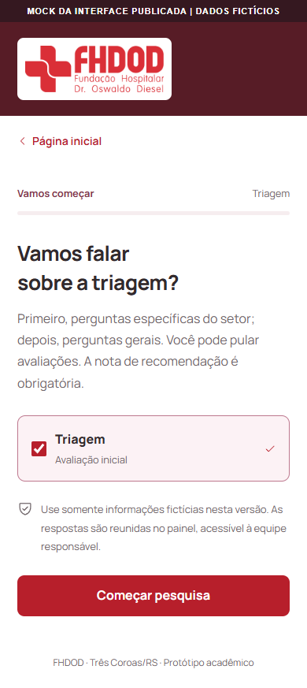

_Entrada da pesquisa e seleção de contexto. Demonstração acadêmica._

### Responder

1. Confira o setor ou marque por onde passou. Toque em **Começar pesquisa**.
2. Em cada avaliação, toque no rosto que melhor representa sua experiência: 1 Muito ruim, 2 Ruim, 3 Regular, 4 Bom ou 5 Muito bom. Toque em **Continuar**. Se não quiser responder, use **Pular pergunta**.
3. Na pergunta de recomendação do hospital, escolha uma nota de 0 a 10. Essa resposta é obrigatória. Toque em **Continuar**.
4. Se quiser, escreva um elogio, reclamação ou sugestão em **Seu comentário**. Não inclua nomes ou informações de saúde. Em **Identificar o atendimento (opcional)**, informe a data e o plantão apenas se souber.
5. Se avaliou algum atendimento com 1 ou 2, aparecerá a opção **Quero receber contato da ouvidoria**. Marque-a somente se quiser retorno. Preencha nome, telefone e o relato; e-mail é opcional. Leia e marque a autorização de contato. Para permanecer anônimo, deixe a opção desmarcada.
6. Toque em **Concluir pesquisa**. Confira o resumo em **Confirmar suas respostas**. Use **Voltar e revisar** para corrigir ou **Confirmar envio** para registrar.
7. Aguarde **Obrigado por compartilhar.** Se ocorrer uma falha, mantenha a página aberta e tente novamente; não é necessário preencher tudo outra vez.

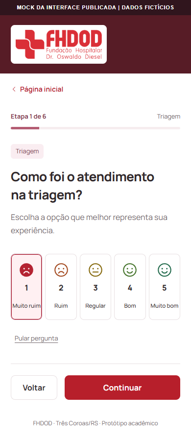

_Avaliação por rostos e opção de pular. Demonstração acadêmica._

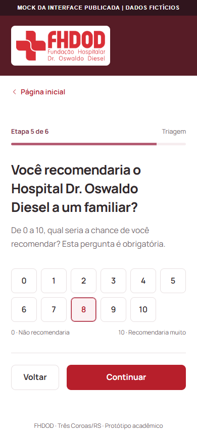

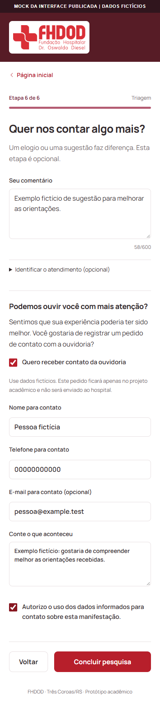

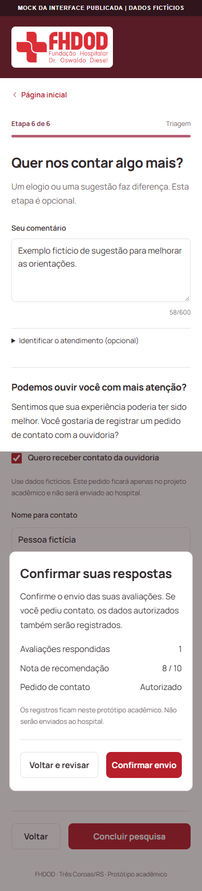

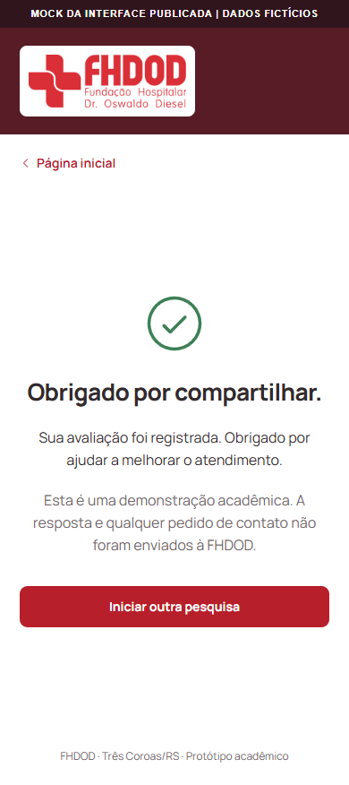

O projeto é uma demonstração acadêmica. Não utilize dados reais e não use a aplicação para urgências ou para esperar retorno do hospital.

## 7. Manual de uso - equipe e gestão

### Entrar

Na página inicial, informe o e-mail e a senha da conta fornecida pelo responsável pelo projeto e toque em **Entrar**. No primeiro acesso com senha temporária, será necessário definir uma senha pessoal com pelo menos 12 caracteres. A senha pessoal não é exibida ao administrador. Cada pessoa deve usar sua própria conta. Ao terminar, use **Sair**.

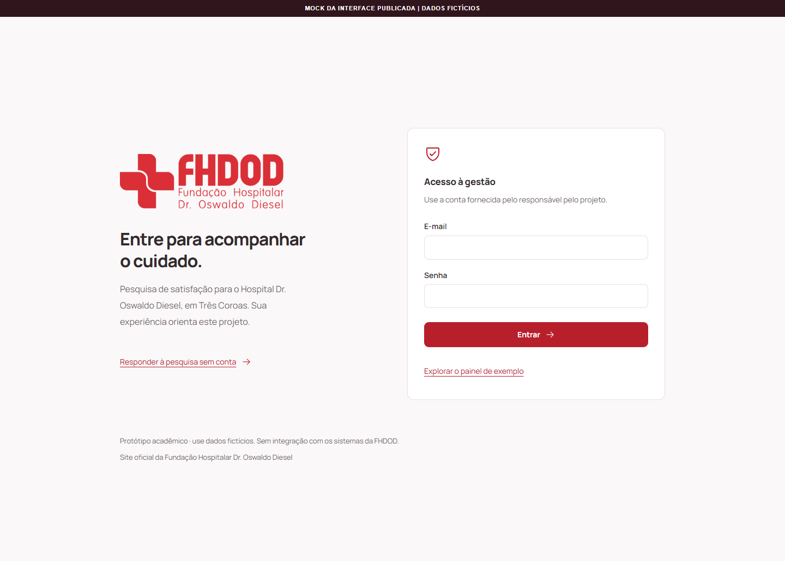

_Entrada da equipe sem credenciais preenchidas. Demonstração acadêmica._

### Consultar o dashboard

1. Acesse **Visão geral**. Nos perfis Super Admin, Admin de Setor e Gestão, confira a origem **Respostas no servidor**. **Dados de exemplo** mostra registros fictícios, e **Respostas deste navegador** é um modo local separado.
2. Use **Setor**, **Plantão**, **Equipe da escala**, **Profissional** e as datas **De** e **Até** para escolher o recorte. O perfil Admin de Setor recebe apenas os dados permitidos do próprio setor. As datas do filtro são datas de envio das pesquisas; não confundir com a data do atendimento usada para cruzar a escala.
3. Leia **Respostas recebidas**, **Satisfação com os serviços**, **Setores avaliados**, a distribuição de NPS e as médias por setor. Um travessão significa que não há base para calcular aquele indicador.
4. **Satisfação** é a porcentagem das avaliações por rostos com notas 4 ou 5 entre as avaliações respondidas. Perguntas puladas não entram nesse cálculo.
5. **NPS** é a porcentagem de notas 9/10 menos a porcentagem de notas 0 a 6. Notas 7/8 são neutras. Varia de -100 a 100. NPS não é a mesma coisa que a média das notas de 0 a 10.
6. O painel consulta o servidor a cada 15 segundos enquanto está visível. Use **Atualizar agora** para antecipar a consulta. Se aparecer erro, aguarde a recuperação ou tente atualizar; não interprete um resultado antigo como recém-atualizado.
7. Para baixar o recorte, toque em **Exportar Excel**. Sem respostas no recorte ou durante falha de consulta, a exportação fica indisponível. A planilha não inclui telefone, e-mail nem os dados do pedido de contato.

No perfil Gestão, os comentários livres são omitidos. Os perfis Ouvidoria e Visualizador veem, na área inicial, somente indicadores agregados; não têm os filtros de respostas individuais nem a exportação de pesquisas.

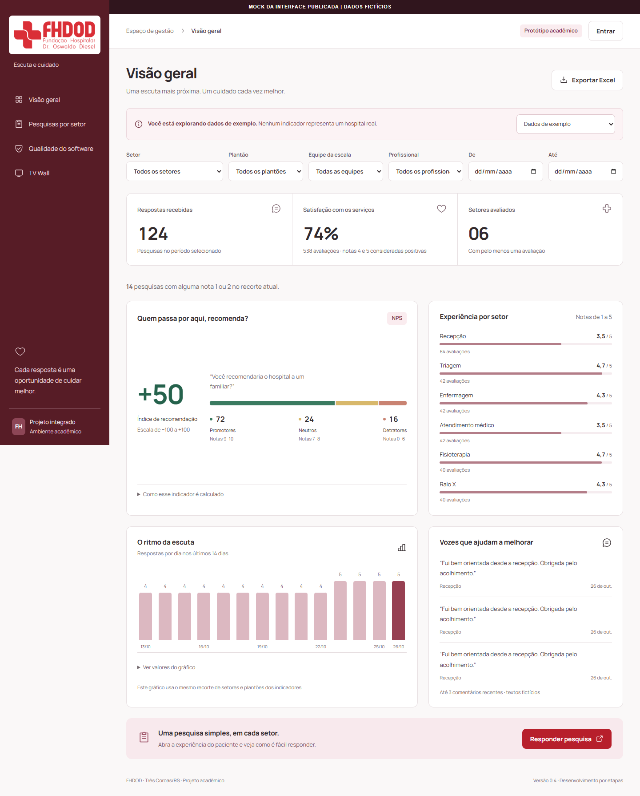

_Dashboard com dados explicitamente de exemplo. Demonstração acadêmica._

### Acompanhar manifestações - Ouvidoria e Super Admin

1. Acesse **Ouvidoria**. Só aparecem pedidos em que o participante escolheu contato e autorizou o uso dos dados.
2. Use o filtro de situação para localizar **Novo**, **Em análise** ou **Concluído**. Toque em **Atualizar manifestações** para recarregar.
3. Leia o relato, os dados de contato e a autorização registrada. O contato fica nessa área restrita, separado dos indicadores e do Excel.
4. Altere a situação conforme o acompanhamento realizado. Na demonstração, essa mudança registra o andamento; não realiza ligação e não envia e-mail ao hospital.

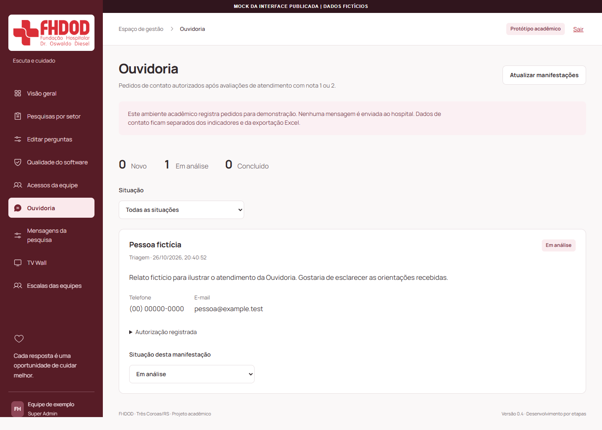

_Ouvidoria com manifestação fictícia. Demonstração acadêmica._

## 8. Manual de uso - administração e escalas

### Super Admin

- **Acessos da equipe:** preencha nome, e-mail e senha temporária; selecione um dos cinco perfis. Em Admin de Setor, escolha também o setor permitido. Toque em **Criar acesso** e entregue a senha à pessoa por um canal adequado. A primeira entrada exige senha pessoal.
- **Editar perguntas:** selecione o contexto, altere perguntas existentes ou adicione uma pergunta ao setor. Salve as alterações. O NPS mantém a pergunta e a escala geral. As respostas anteriores preservam a pergunta e versão usadas quando foram enviadas.
- **Mensagens da pesquisa:** edite convite, autorização, confirmação, mensagem após envio e e-mail da Ouvidoria; salve. A edição do endereço de e-mail não ativa integração de envio automático.
- **Escalas das equipes:** cadastre e revise as escalas de todos os setores.

### Admin de Setor

Pode consultar resultados estruturados, exportar o recorte, editar perguntas e cadastrar escalas do próprio setor. Não administra contas, mensagens gerais ou pedidos de contato. Comentários livres são omitidos.

### Gestão

Consulta resultados estruturados de todos os setores, aplica filtros e exporta Excel. Pode consultar escalas, mas não alterá-las. Não acessa telefones, relatos de contato ou comentários livres e não administra contas/perguntas.

### Ouvidoria

Consulta indicadores agregados e trata os pedidos de contato autorizados. Não consulta a base de respostas individuais, não exporta pesquisas, não altera perguntas nem administra contas ou escalas.

### Visualizador

Consulta apenas os indicadores agregados. Não consulta respostas individuais, contato ou relatórios Excel e não altera configurações.

### Cadastrar ou corrigir uma escala - Super Admin e Admin de Setor

1. Abra **Escalas das equipes** e escolha o **Mês da escala**.
2. Selecione **Setor da escala**, **Data do atendimento**, **Turno da escala** e informe o rótulo da **Equipe**, como “Equipe A”. Não inclua dados pessoais.
3. Toque em **Salvar escala**. Para alterar um registro existente, use **Editar** na tabela.
4. Se outra pessoa já tiver alterado aquele registro, recarregue o mês e abra a linha novamente antes de salvar. Isso evita sobrescrever a alteração sem revisão.
5. A associação à pesquisa só ocorre se o paciente informou data e turno compatíveis. Alterar uma escala depois não muda a equipe que já foi registrada nas respostas anteriores.

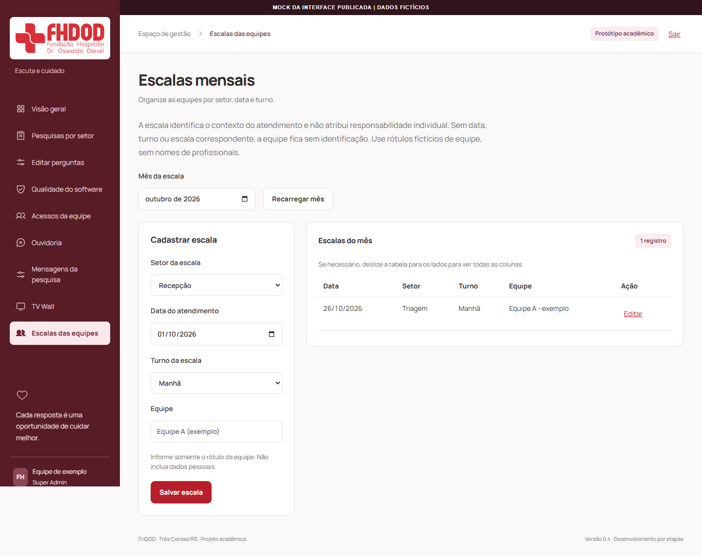

_Escala de equipe fictícia. Demonstração acadêmica._

## 9. Manual de uso - QR Codes e TV Wall

### QR Codes

Em **Pesquisas por setor**, escolha **Copiar link**, **Abrir pesquisa** ou **Baixar QR**. Gere e baixe os QR Codes na versão publicada. Um endereço local iniciado por `127.0.0.1` não funciona no celular de outra pessoa. Cada um dos seis setores tem seu próprio endereço.

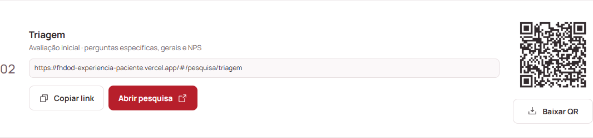

_QR Code da Triagem no domínio publicado. Demonstração acadêmica._

### TV Wall

1. Abra a opção **TV Wall** ou o endereço público do sistema terminado em `#/tv-wall` no navegador da TV ou computador conectado à tela. Não é necessário login para essa tela.
2. Toque em **Tela cheia** se desejar. Para sair, use o botão correspondente ou Esc no teclado.
3. Acompanhe NPS, satisfação e médias por setor. São consideradas pesquisas enviadas nos últimos 30 dias. Os dados são consultados a cada 15 segundos.
4. Valores com menos de cinco pesquisas elegíveis ficam ocultos. Um traço por amostra insuficiente não significa nota zero, erro ou falta de registro. Os mínimos são verificados separadamente por indicador e setor.
5. A tela não mostra relatos individuais, nomes, telefones, plantões ou equipes. Se a conexão falhar, um aviso diferencia dados sem atualização de indicadores indisponíveis.
6. Para demonstrar a composição visual sem uma base coletada suficiente, use o endereço terminado em `#/tv-wall?dados=exemplo`, identificado como demonstração. Esses exemplos não são resultados do hospital.

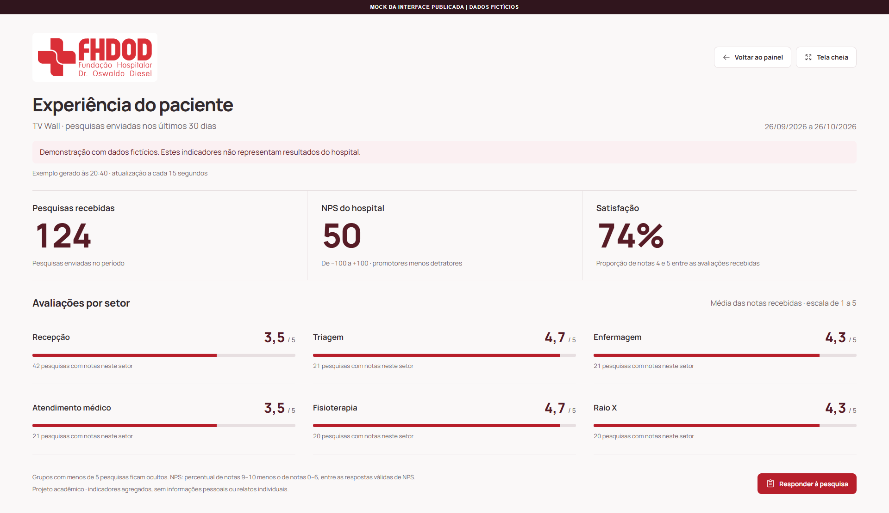

_TV Wall com dados identificados como fictícios. Demonstração acadêmica._

## 10. Processo e evidências

### Etapas realizadas

1. Análise do problema e do material da disciplina; separação entre qualidade do software e requisitos da experiência do paciente.
2. Primeira versão da pesquisa por etapas e do painel, registrada no histórico em 02/10/2026.
3. Adaptação da identidade à FHDOD, autenticação, administração e contato consentido; revisão de ícone e do botão de pular em 03/10/2026.
4. Revisão do novo PDF e ampliação para cinco perfis, QR Codes, TV Wall, escalas e persistência em nuvem em 26/10/2026; commit `3fb5d2a`.
5. Verificação funcional e visual com cenários fictícios e limpeza dos registros temporários. Publicação em https://fhdod-experiencia-paciente.vercel.app e correção do empacotamento da API em `4d20751`, em 26/10/2026. A interface publicada foi usada nas capturas do manual e do mock. O relatório público de 27/10/2026 confirmou os cinco perfis, cadastro de escala, pesquisa móvel com NPS zero e contato consentido, dados no painel/Ouvidoria, Excel, seis QR Codes e atualização da TV. Os registros fictícios próprios foram removidos.
6. Conferência do DOCX, consolidação do PDF único, fluxo conectado e mockups editáveis no Figma; revisão da jornada para agrupar também perguntas cadastradas posteriormente no setor correspondente, mantendo as gerais ao fim.
7. Em 5/11/2026, recuperação do banco pausado por inatividade no plano gratuito e verificação pública de site, perguntas e TV com HTTP 200 e JSON válido, sem gravar dados, trocar credenciais ou contratar recursos pagos.

### Ferramentas usadas

React e TypeScript para a interface; Vite para desenvolvimento/build; GSAP para uma animação sutil respeitando redução de movimento; Node.js para a API; SQLite no ambiente local; PostgreSQL no Supabase para persistência compartilhada; Vercel para hospedagem; QR Code gerado localmente; ExcelJS para exportação; Playwright e verificações de acessibilidade para os fluxos de navegador; Git/GitHub para histórico e colaboração; Codex como apoio à implementação e revisão. Figma/FigJam documentam a navegação e o mock. As personas são personagens de projeto; não foram feitas entrevistas, pesquisa com usuários reais ou homologação institucional.

### Verificações já registradas no desenvolvimento

A revisão reuniu 122 cenários automatizados aprovados: 12 unitários, 49 de API/PostgreSQL e 61 de navegador. Após a correção do agrupamento de perguntas pela jornada, os 12 unitários e os dois fluxos de pesquisa em desktop/celular passaram novamente; a API não usa esse helper. Build e formatação também passaram após a alteração. Os testes usam bancos temporários e dados fictícios, sem credenciais de produção.

A checagem pública de 27/10 percorreu cinco perfis, escala, pesquisa com NPS zero/nota baixa/contato, painel/Ouvidoria, Excel, QR Codes e TV, com limpeza dos registros fictícios próprios. Em 5/11, a reativação do banco foi confirmada pelo estado `ACTIVE_HEALTHY` e pelas respostas HTTP 200 do site, `/api/questions` e `/api/wall`, com JSON válido nas APIs. Esta última conferência foi somente de leitura e não repete toda a homologação funcional.

Essas verificações demonstram os cenários executados; não provam ausência de defeitos nem substituem avaliação com usuários reais.

### Ajustes e limites visíveis

- Corrigido o ícone para usar a cruz do hospital e removida a borda do botão de pular, conforme a revisão do estudante.
- Corrigido o reinício da pesquisa para limpar a data do atendimento anterior em tablets compartilhados; regressão validada no fluxo completo em desktop e celular.
- Ampliados os perfis para os cinco pedidos no novo enunciado, mantendo restrições também no servidor.
- Preservados os modos de exemplo/local, mas diferenciados das respostas no servidor.
- Adicionado o cruzamento por equipe com versão da escala, evitando atribuição retroativa.
- TV Wall com dados agregados e amostra mínima; planilha sem contatos.
- Persistência em nuvem separada do banco local e conexões TLS validadas.
- Perguntas adicionadas posteriormente são agrupadas pela jornada do setor, mantendo perguntas gerais ao final.
- A instalação gratuita pode ser pausada por inatividade; antes da apresentação, conferir a API e o banco, e reativar o projeto existente se necessário. A restauração de 5/11 preservou dados e credenciais.
- Convites automáticos, integração com prontuário e comunicação real com a Ouvidoria dependem de definição e autorização institucional; não são recursos entregues.

## Plano de testes e caso de melhoria

| Caso            | Critério mensurável                                                                                                                                    |
| --------------- | ------------------------------------------------------------------------------------------------------------------------------------------------------ |
| NPS e opcionais | Bloquear a conclusão sem NPS; aceitar NPS zero; rostos pulados não entram no denominador da satisfação.                                                |
| Cinco perfis    | Sem sessão, recurso restrito retorna 401; perfil sem permissão retorna 403; Admin de Setor recebe apenas o próprio setor.                              |
| Ouvidoria       | Convite após rosto 1/2; contato desmarcado mantém participação anônima; opt-in exige dados e autorização. Excel/TV contêm zero contatos.               |
| QR Codes        | Os seis PNGs apontam ao domínio publicado e ao setor correto; nenhum aponta a localhost.                                                               |
| TV              | Com quatro pesquisas elegíveis, ocultar indicador/grupo; com cinco, divulgar se o denominador daquele indicador for suficiente. Zero relatos/contatos. |
| Escalas         | Alterar escala não reescreve vínculo de resposta antiga; atualização com versão antiga retorna 409.                                                    |
| Reenvio         | Reenviar o mesmo identificador não cria segunda pesquisa; falha mantém respostas para tentar novamente.                                                |
| Nova pesquisa   | Iniciar outra pesquisa deixa a data do atendimento vazia, em desktop e celular.                                                                        |

**Erro humano → defeito → falha:** esquecer a limpeza da data ao reiniciar o formulário → ausência de `setAttendanceDate('')` no reinício → tablet reutilizava a data do paciente anterior. A correção limpa o campo; testes de regressão em desktop e celular verificam a data vazia. Não se infere que o defeito tenha ocorrido com pacientes reais.

## 11. Roteiro da apresentação de oito minutos

- **0:00-0:50:** problema do papel, proposta e duas personas.
- **0:50-3:10:** abrir QR/link de setor; responder/pular rostos; NPS; mostrar caminho de nota baixa e contato opcional; confirmar o envio fictício.
- **3:10-4:50:** dashboard com origem correta; atualização da resposta; filtros de setor, plantão/equipe e período; leitura do NPS e exportação.
- **4:50-5:40:** Ouvidoria e separação dos dados de contato; explicar os cinco perfis.
- **5:40-6:30:** TV Wall público, atualização e regra de amostra mínima. Se a base estiver pequena, mostrar a diferença entre o estado real e o exemplo identificado.
- **6:30-7:20:** escala/contexto e pelo menos quatro decisões justificadas pelas personas.
- **7:20-8:00:** mostrar links do sistema e Figma, manual e evidências de verificação; explicitar limites da demonstração.

## 12. Conferência objetiva do enunciado

| Exigência                                                            | Situação                                                  | Evidência                                                                                        |
| -------------------------------------------------------------------- | --------------------------------------------------------- | ------------------------------------------------------------------------------------------------ |
| URL e QR por setor                                                   | Implementado                                              | `SurveyLinks.tsx`; conferir downloads no domínio público                                         |
| Uma avaliação geral obrigatória; demais opcionais                    | Implementado                                              | NPS ao fim; rostos e comentário podem ser pulados; contato é um opt-in com dados condicionais    |
| Celular/tablet e etapas curtas                                       | Implementado e testado no desenvolvimento                 | Capturas ilustrativas incluídas no PDF                                                           |
| Perguntas pela jornada/contexto                                      | Implementado                                              | Setores selecionados e específicas antes das gerais                                              |
| Elogio/reclamação/sugestão e anonimato/retorno                       | Implementado conforme decisões confirmadas pelo estudante | Contato opcional somente após rosto1/2; não há envio real ao hospital                            |
| Cruzamento escala mensal                                             | Implementado                                              | Setor + data + turno e snapshot de equipe                                                        |
| Cinco perfis                                                         | Implementado                                              | Permissões no servidor; manual acima                                                             |
| Dashboard e TV refletindo pesquisas                                  | Implementado, testes locais+nuvem aprovados               | Cadeia pública verificada em 27/10/2026; TV oculta amostras pequenas                             |
| Excel                                                                | Implementado e testado                                    | Exporta recorte sem contato                                                                      |
| Duas personas com oito campos pedidos                                | Incluídas no relatório e no PDF                           | Personas e relação com as decisões incluídas no PDF                                              |
| Figma conectado do QR ao agradecimento com nota baixa                | Construído e acessível sem login                          | FigJam com 17 etapas/decisões e 21 conexões; visualização pública conferida em 5/11/2026         |
| Mock pesquisa/dashboard/TV e decisões indicadas                      | Incluído no PDF e em arquivo Figma editável               | Seis telas da pesquisa, dashboard e TV com dados fictícios e decisões anotadas                   |
| Front publicado com link funcional                                   | Publicado e API restabelecida                             | https://fhdod-experiencia-paciente.vercel.app; leitura pública confirmada em 5/11/2026           |
| Manual ilustrado e fiel à aplicação                                  | Manual ilustrado incluído no PDF                          | Paciente, gestão e TV em linguagem simples e com capturas                                        |
| Processo e mínimo quatro decisões                                    | Registrado                                                | Sete decisões implementadas e política proposta de retenção; histórico e publicação documentados |
| PDF único com nomes/cursos, links, personas, mock, manual e processo | Consolidado                                               | PDF com identificação, links, personas, mock, manual, processo e testes                          |
| Apresentação funcionando em aula                                     | A executar pelos integrantes                              | Roteiro preparado; apresentação não pode ser declarada concluída pelo agente                     |

### Fontes primárias do conteúdo

- Enunciado local: `Atividade_Experiencia_do_Paciente.docx`, enviado em 3/11/2026, e prazo atualizado do Classroom fornecido pelo estudante.
- Produto: fontes de `src/` e `server/`, versão 0.4.0, histórico até `90f4afd` e revisão da entrega de 5/11/2026.
- Histórico Git e relatórios locais `.local/publicacao-status.md` e `.local/qa-cloud-browser-result.json`.
- Os documentos antigos em `docs/` e `respostas/` tratam do exercício teórico MediCare/ISO e não devem ser apresentados como substitutos dos entregáveis do novo PDF.
